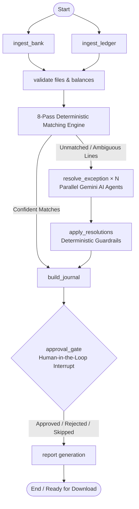
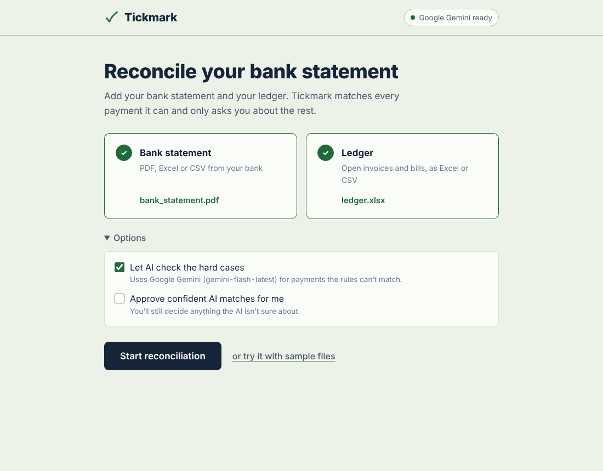
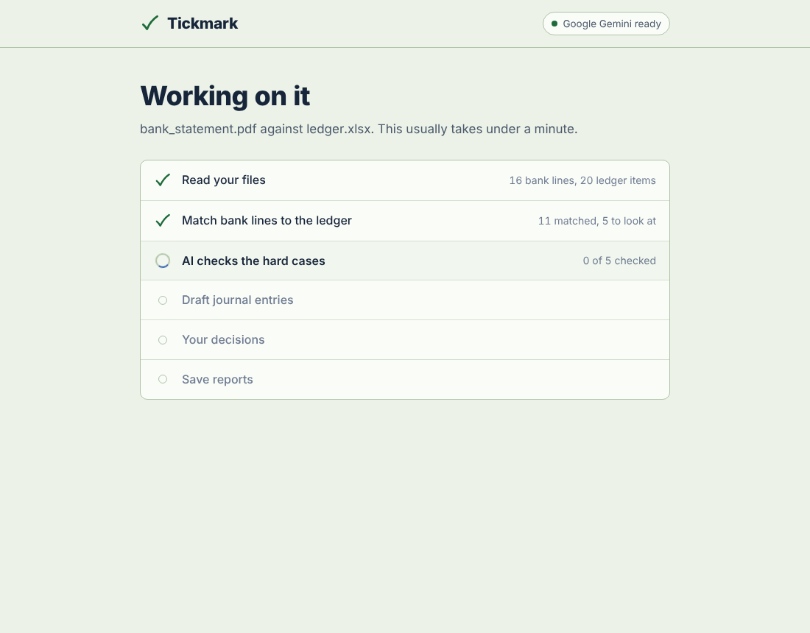
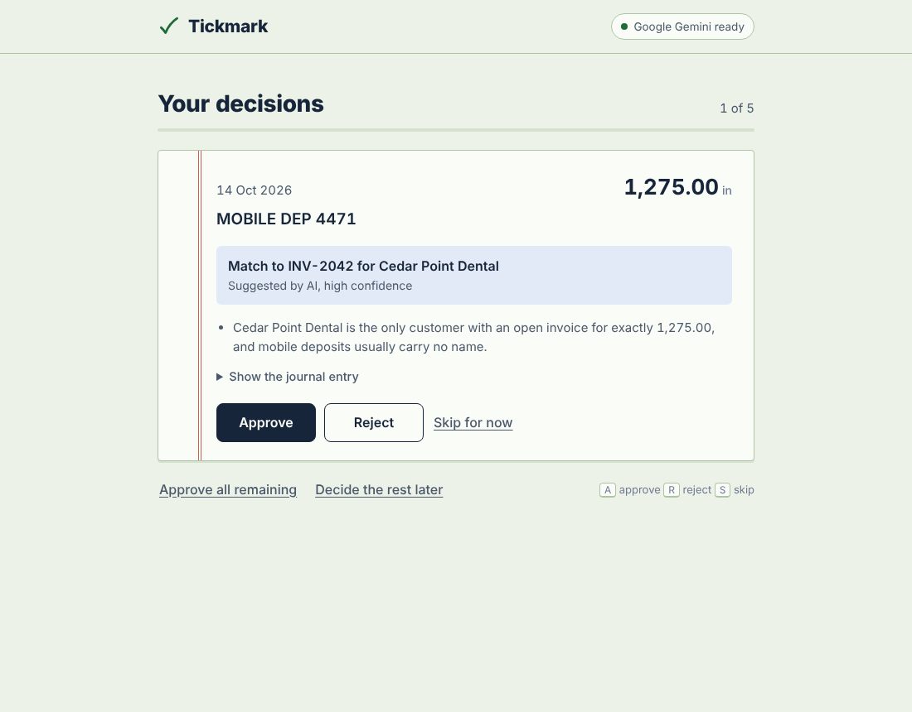
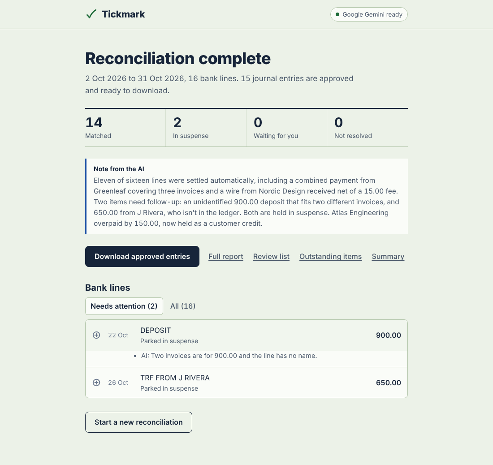

# 🏦 Tickmark: Automated Bank Reconciliation AI Agent

**Tickmark** is an intelligent, automated bank reconciliation system powered by **LangGraph** and **Google Gemini**. It automatically reconciles bank statements against an organization's accounting ledger, matches transactions using a multi-pass deterministic engine, deploys autonomous AI agents to investigate difficult or ambiguous exceptions, and generates balanced, double-entry accounting journal entries with human-in-the-loop approval.

---

## 📌 Table of Contents
- [What Problem Does This Solve?](#-what-problem-does-this-solve)
- [How It Works (Workflow Architecture)](#-how-it-works-workflow-architecture)
- [Key Features](#-key-features)
- [Tech Stack](#-tech-stack)
- [Project Structure](#-project-structure)
- [Installation & Setup Guide](#-installation--setup-guide)
- [How to Run](#-how-to-run)
  - [1. Web User Interface (Recommended)](#1-web-user-interface-recommended)
  - [2. Command-Line Interface (CLI)](#2-command-line-interface-cli)
  - [3. Health Check](#3-health-check)
- [Web UI Walkthrough](#-web-ui-walkthrough)
- [Configuration (.env Options)](#-configuration-env-options)

---

## 💡 What Problem Does This Solve?

In business accounting, matching bank transactions with internal ledger invoices (Bank Reconciliation) is one of the most tedious manual tasks:
* **Spelling Discrepancies**: Bank statements often abbreviate or truncate party names (e.g. `TRF ACM TRD` vs ledger's `Acme Trading Ltd`).
* **Combined Payments**: One customer payment covering multiple separate invoices.
* **Transit Fees & Shortfalls**: Wire fees deducted before funds arrive at the bank.
* **Missing References**: Payments without quoted invoice or order numbers.

Tickmark solves this by running an 8-stage deterministic rules engine for straightforward matches, and deploying **Gemini AI agents** to inspect ledger records, reason over fuzzy names and dates, and propose balanced journal entries for human review.

---

## 🔄 How It Works (Workflow Architecture)

Tickmark uses a stateful **LangGraph** orchestration pipeline:



### Pipeline Stages
1. **`ingest_bank` & `ingest_ledger`**: Reads statements (PDF, CSV, Excel) and ledger files. Verifies opening balance + transactions = closing balance.
2. **`validate`**: Detects duplicate entries, reused invoice numbers, and missing headers.
3. **`match`**: Runs an 8-pass matching engine:
   - Quoted invoice/bill references.
   - Pre-booked ledger entries.
   - Exact amount + fuzzy party name match.
   - Subset-sum matching (one payment covering several customer invoices).
   - Single invoice paid net of bank transaction fees.
   - Partial payments and overpayments.
   - Unique exact amounts with no name evidence (flagged for review).
   - Bank service fees and interest.
4. **`resolve_exception` (AI Investigation)**: Spawns parallel Gemini agents via LangGraph `Send` for every remaining unsettled item. Agents use read-only lookup tools to investigate ledger items.
5. **`apply_resolutions` (Guardrails)**: Validates AI proposals against strict financial safety rules (verifies IDs, checks directions, prevents double payment).
6. **`build_journal`**: Generates balanced double-entry (Debit = Credit) journal entries.
7. **`approval_gate` (Human-in-the-Loop)**: Pauses execution using LangGraph `interrupt()`, presenting interactive approval cards in the UI.
8. **`report`**: Exports CSV journal entries ready to import into ERP/accounting software (QuickBooks, Xero, SAP).

---

## 🛠️ Tech Stack

### AI & Agent Orchestration
* **LangGraph (v1.2+)**: Manages state graphs, parallel branch fan-out (`Send`), checkpoints (`MemorySaver`), and human-in-the-loop pauses (`interrupt()`).
* **LangChain (v1.4+)**: Structured outputs, agent prompt chaining, and tool-calling infrastructure.
* **Google Gemini (`gemini-flash-latest` / Gemini 2.5 / 3+)**: LLM provider for investigating ambiguous transactions. Also compatible with Claude and OpenAI.

### Backend & API
* **Python 3.10+**: Core runtime.
* **FastAPI**: Asynchronous web framework providing REST APIs (`/api/runs`, `/api/info`, `/api/runs/{id}/decisions`).
* **Uvicorn**: High-performance ASGI production server.
* **Pydantic (v2)**: Strict type models for accounting data (BankTxn, LedgerItem, JournalEntry).

### Data & Document Processing
* **pdfplumber & pdfminer.six**: High-fidelity text and table extraction from PDF bank statements.
* **openpyxl**: Excel spreadsheet (`.xlsx`, `.xlsm`) reading and writing.
* **RapidFuzz**: High-performance Jaro-Winkler string similarity matching for party names.

### Frontend
* **Vanilla HTML5, Modern CSS & ES6+ JavaScript**:
  - Zero heavy frontend dependencies (no complex build steps or Node.js required).
  - Drag-and-drop file upload interface.
  - Real-time polling for step progress.
  - Dark mode and light mode support with responsive layout.
  - Keyboard shortcuts (<kbd>A</kbd>, <kbd>R</kbd>, <kbd>S</kbd>) for fast decision-making.

---

## 📁 Project Structure

```text
AI Agent/
├── server.py                         # FastAPI web server module
├── index.html                        # Single-page UI application
├── .env                              # API keys and environment configuration
├── tickmark-agent/
│   └── tickmark-agent/
│       ├── pyproject.toml            # Project packaging metadata
│       ├── requirements.txt          # Python dependencies
│       ├── tickmark/
│       │   ├── cli.py                # Command-line interface commands (ui, run, check)
│       │   ├── config.py             # Settings, model configuration, credentials
│       │   ├── models.py             # Pydantic schemas (BankTxn, LedgerItem, JournalEntry)
│       │   ├── journal.py            # Double-entry journal builder & balance checker
│       │   ├── reporting.py          # Summary and CSV export generators
│       │   ├── agents/
│       │   │   ├── resolver.py       # Gemini AI exception investigation agent
│       │   │   ├── tools.py          # Ledger lookup & calculation tools for the agent
│       │   │   └── extractors.py     # Vision / LLM fallback column mapping
│       │   ├── graph/
│       │   │   ├── build.py          # LangGraph construction and checkpointer setup
│       │   │   ├── nodes.py          # Graph node implementations
│       │   │   └── state.py          # Global graph state schema
│       │   ├── ingest/               # PDF, CSV, Excel parsers and validators
│       │   ├── matching/             # 8-pass deterministic matching & RapidFuzz engine
│       │   └── ui/                   # Web app server and static assets
│       └── samples/                  # Sample bank statements and ledgers for testing
```

---

## 🚀 Installation & Setup Guide

### 1. Prerequisites
* **Python 3.10** or higher installed.
* A **Google Gemini API Key** (get one free at [Google AI Studio](https://aistudio.google.com/apikey)).

### 2. Set Up Virtual Environment (Recommended)
Open PowerShell or your terminal in the project root:

```powershell
# Create virtual environment
python -m venv .venv

# Activate virtual environment
# Windows:
.venv\Scripts\activate
# Linux/macOS:
source .venv/bin/activate
```

### 3. Install Dependencies
Install all required libraries:

```powershell
pip install -r .\tickmark-agent\tickmark-agent\requirements.txt
```

Then install the Tickmark package in editable mode:
```powershell
pip install --no-build-isolation --no-deps -e .\tickmark-agent\tickmark-agent
```

### 4. Configure Your API Key
Create a `.env` file in the root directory (or edit `tickmark-agent/tickmark-agent/.env`):

```ini
# Add your Google Gemini API key:
GOOGLE_API_KEY=AIzaSy...your_gemini_api_key_here

# Optional model override (defaults to gemini-flash-latest)
TICKMARK_MODEL=google_genai:gemini-flash-latest

# Optional rate limit cap for free-tier accounts
TICKMARK_RPM=8
```

---

## 💻 How to Run

### 1. Web User Interface (Recommended)
To launch the interactive web dashboard:

```powershell
python -m tickmark ui
```

* Open your browser at **[http://localhost:8765](http://localhost:8765)**.
* Click **"or try it with sample files"** to immediately test reconciliation with bundled data, or drop your own bank statement and ledger.

### 2. Command-Line Interface (CLI)
To run reconciliation purely from the terminal:

```powershell
python -m tickmark run --bank .\tickmark-agent\tickmark-agent\samples\bank_statement.pdf --ledger .\tickmark-agent\tickmark-agent\samples\ledger.xlsx --out out/
```

Options:
* `--interactive`: Pauses in terminal for you to approve items.
* `--no-llm`: Runs deterministic rules only (without calling Gemini).
* `--ai-auto-approve`: Automatically approves high-confidence AI decisions.

### 3. Health Check
Verify your Gemini API key and tool-calling compatibility:

```powershell
python -m tickmark check
```

---

## 🖥️ Web UI Walkthrough

### 1. Upload Screen
Drop your Bank Statement (PDF, CSV, or Excel) and Ledger (CSV or Excel), or click *"or try it with sample files"*.



---

### 2. Live Agent Working Screen
Watch the real-time LangGraph pipeline execute: file parsing, deterministic matching passes, and parallel AI exception investigation.



---

### 3. Human-in-the-Loop Decision Screen
Each unsettled transaction appears as an interactive card showing the original bank line, the suggested match, and the reasoning.
* Press **Approve** (<kbd>A</kbd>)
* Press **Reject** (<kbd>R</kbd>)
* Press **Skip** (<kbd>S</kbd>)



---

### 4. Reconciliation Complete & Downloads
View the complete breakdown (Matched, Suspense, Waiting, Unresolved) and download the balanced `approved_entries.csv`.



---

## ⚙️ Configuration (.env Options)

| Key | Description | Default |
|---|---|---|
| `GOOGLE_API_KEY` | Gemini API key | None (required for AI steps) |
| `TICKMARK_MODEL` | LLM model identifier | `google_genai:gemini-flash-latest` |
| `TICKMARK_RPM` | Maximum API requests per minute | Unlimited |
| `TICKMARK_MAX_CONCURRENCY` | Maximum parallel AI resolver agents | `4` |
| `TICKMARK_THRESHOLD` | Confidence score required for auto-approval | `85` |
| `TICKMARK_FEE_TOLERANCE` | Allowable shortfall for bank fees | `50.0` |
| `TICKMARK_DATE_WINDOW` | Maximum days an invoice may precede payment | `90` |
| `TICKMARK_NAME_THRESHOLD` | RapidFuzz similarity threshold (0.0 to 1.0) | `0.72` |

---

## 🛡️ Financial Safety & Guardrails
* **No Direct Write from AI**: The LLM never writes journal entries directly. It only suggests item links.
* **Deterministic Double-Entry Integrity**: Journal entries are constructed by deterministic Python code ensuring $\sum \text{Debits} = \sum \text{Credits}$. Unbalanced entries are strictly rejected.
* **Anti-Double-Claim**: Invoices cannot be matched more than once.
